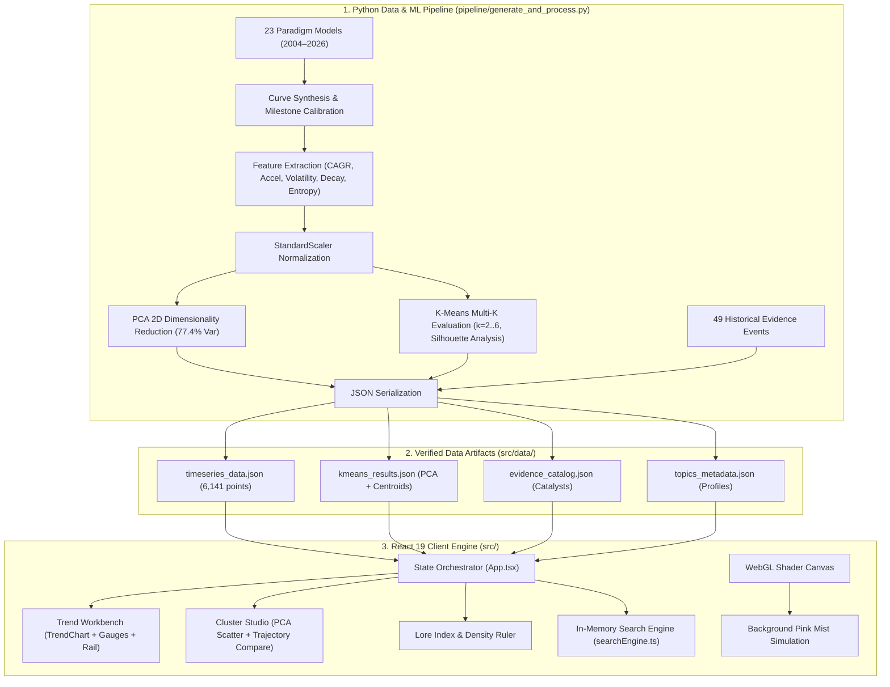

# TECH LORE

An archaeological workbench for modern computing paradigms (2004–2026), tracing the lifecycle, inflection catalysts, and structural diffusion of emerging technologies before they became ubiquitous.

TECH LORE couples historical time-series modeling with unsupervised machine learning to examine how breakthrough technologies emerge, crest, stabilize, or decline. By combining an interactive multi-topic workbench, a catalog of documented catalyst events, and a PCA/K-Means cluster laboratory, the system treats search volume trajectories and research milestones as an empirical record of technological momentum.

---

## Overview

### The Problem

In technological discourse, paradigm shifts are routinely characterized as sudden and inevitable revolutions. Retrospective accounts compress years of incremental breakthroughs into overnight triumphs, while obscure research trajectories, false starts, and sustained plateau phases are forgotten.

This flattened perspective obscures why technologies with identical initial momentum diverge radically:
- Why **Large Language Models** and **Generative AI** sustained breakout adoption post-crest, while the **Metaverse** suffered rapid bubble collapse.
- How foundational workhorses like **Natural Language Processing** and **Machine Learning** maintain multi-decade utility with low volatility.
- When precursor architectures like **Expert Systems** and **Support Vector Machines** quietly yielded to deep learning representations.

### What TECH LORE Explores

TECH LORE provides an editorial and quantitative lens for investigating these questions:
1. **Inflection Archaeology**: Cross-referencing sudden search velocity surges with documented catalyst events (ArXiv preprints, benchmark breakthroughs, product releases, regulatory actions, and hardware milestones).
2. **Trajectory Classification**: Grouping technologies into mathematical diffusion archetypes based on compound growth, acceleration, volatility, persistence, and decay.
3. **Comparative Dynamics**: Overlaying up to six concurrent topics on normalized scales to analyze lead-lag relationships, architectural handoffs, and paradigm substitutions.

---

## Core Capabilities

### 1. Historical Technology Horizon (2004–2026)
- **Continuous 22-Year Timeline**: 267 continuous monthly timesteps spanning from January 2004 through March 2026.
- **Archive Density Ruler**: Interactive horizontal scrubber showing the historical distribution and concentration of technological catalysts across years.
- **Temporal Scrubbing**: Immediate era-filtering to isolate catalysts and topic milestones from specific technology waves (e.g., Deep Learning Renaissance 2012–2016, Transformer Explosion 2017–2020, Generative AI Surge 2022–2026).

### 2. Multi-Topic Archival Workbench
- **Curated Catalog of 23 Paradigms**: Spanning modern Generative AI, Machine Learning foundations, Classical AI, and Infrastructure.
- **Dynamic Multi-Series SVG Engine**: High-performance SVG line visualization supporting up to 6 simultaneous topic overlays with focused topic prioritization and clear overlays functionality.
- **Milestone Annotation System**: Direct chart pin markers mapping documented historical catalysts to the exact month and interest coordinate on the curve.
- **Quantitative Measurement Bar**: Real-time statistical gauges for the primary focused topic displaying CAGR, 3-Month Acceleration, Rolling Volatility ($\sigma$), Peak Intensity, Persistence (months), and Peak-to-Current Decay Ratio.

### 3. Dimensional Projection and Clustering Lab
- **2D PCA Projection Plane**: Principal Component Analysis reducing 6 normalized statistical dimensions into an interpretable 2D coordinate space retaining 77.4% of total dataset variance ($PC_1: 53.0\%$, $PC_2: 24.4\%$).
- **Dynamic K-Means Explorer**: Interactive cluster selection across $k \in [2, 6]$ with real-time centroid recalculation and cluster membership hulls.
- **Silhouette Diagnostic**: Mathematical cohesion scoring indicating $k=5$ as the optimal mathematical clustering ($s = 0.428$), alongside $k=4$ for high-level macro archetypes.
- **Collision-Free Label Positioning**: Deterministic radial offset algorithm ensuring topic labels remain clearly legible across all cluster densities without overlapping.

### 4. Topic Comparison & Trajectory Analysis
- **Side-by-Side Trajectory Inspection**: Select any topic from the dimensional projection to run comparative diagnostics against the active primary topic.
- **Metric Delta Vectors**: Visual delta indicators comparing growth velocity, volatility, persistence, and decay between topics.
- **Archetype Narrative Synthesis**: Automated structural analysis explaining why two technologies diverged (e.g., comparing the rapid decay of transient hype spikes against sustained platform expansions).

### 5. Verified Catalyst Catalog & Provenance
- **49 Documented Historical Events**: Every inflection point is anchored to an empirical catalyst categorized into 7 domain badges:
  - `Research Breakthroughs` (ArXiv preprints, algorithmic breakthroughs)
  - `Product & Model Releases` (Major commercial releases, foundation models)
  - `Search Velocity Spikes` (Anomalous public interest inflections)
  - `Hardware & Infrastructure` (GPU clusters, tensor processing units)
  - `Regulatory & Governance` (Executive orders, EU AI Act, antitrust actions)
  - `Cultural Spotlights` (Mainstream media coverage, consumer virality)
  - `Market & Industry Shocks` (Corporate realignments, venture capital inflection)
- **Provenance Transparency**: Each catalyst includes citation source, verified URL, date, velocity delta, and confidence rating (0.80–0.98).

---

## System Architecture

TECH LORE is architectured as a decoupled data-intelligence system. The mathematical modeling and unsupervised learning pipeline runs offline in Python, generating verified, statically typed JSON artifacts that drive an entirely client-side, zero-dependency SVG visualization engine in React 19.



### Analytical Methods

1. **Compound Annual Growth Rate (CAGR)**:
   Calculated across the 22-year window comparing trailing 12-month mean to baseline 12-month mean:
   $$\text{CAGR} = \left( \frac{\bar{S}_{\text{recent}}}{\bar{S}_{\text{initial}}} \right)^{\frac{1}{22}} - 1$$

2. **Maximum Acceleration**:
   The maximum positive 3-month rolling differential, isolating rapid viral adoption inflection:
   $$\text{Accel}_{\max} = \max_t \left( S_t - S_{t-3} \right)$$

3. **Rolling Volatility**:
   The average 12-month rolling standard deviation measuring trajectory turbulence:
   $$\sigma_{\text{avg}} = \frac{1}{N - 11} \sum_{t=12}^{N} \sigma_{t-11:t}$$

4. **Half-Peak Persistence**:
   The cumulative number of monthly timesteps where search interest remained at or above 50% of the maximum historical peak:
   $$\text{Persistence} = \sum_{t=1}^{N} \mathbf{1}_{\{S_t \ge 0.5 \cdot S_{\max}\}}$$

5. **Decay Ratio**:
   The proportional decay from peak interest to the trailing 6-month average:
   $$\text{Decay} = \frac{S_{\max} - \bar{S}_{\text{trailing 6m}}}{S_{\max}}$$

6. **Normalized Shannon Entropy**:
   Quantifying whether search interest was concentrated in a single burst or uniformly distributed across time:
   $$H_{\text{norm}} = \frac{-\sum p_i \ln p_i}{\ln N}, \quad p_i = \frac{S_i}{\sum S_k}$$

---

## Technology Stack

| Domain | Technology | Version | Purpose |
| :--- | :--- | :--- | :--- |
| **Framework** | [React](https://react.dev/) | 19.3.1 | Core UI component model and reactive state orchestration |
| **Language** | [TypeScript](https://www.typescriptlang.org/) | 7.0.2 | End-to-end static typing and interface contracts |
| **Build Tooling** | [Vite](https://vitejs.dev/) | 8.3.5 | Fast ESM development server and Rollup production bundler |
| **Linter** | [Oxlint](https://oxc.rs/) | 1.89.0 | High-performance Rust-based static code analysis |
| **Icons** | [Lucide React](https://lucide.dev/) | 1.64.0 | Editorial and analytical interface icons |
| **Graphics** | WebGL / GLSL | Custom | Lightweight procedural pink mist background shader |
| **Data Engine** | Python | 3.10+ | Historical curve generation, feature engineering, and JSON export |
| **Machine Learning**| [scikit-learn](https://scikit-learn.org/) | Latest | StandardScaler, PCA 2D reduction, K-Means clustering, Silhouette score |
| **Numerical Computing** | NumPy & Pandas | Latest | Time-series rolling operations, vector differentials, matrix transforms |

---

## Project Structure

```
trendarchaeology/
├── pipeline/
│   └── generate_and_process.py     # Python ML pipeline (feature engineering, PCA, K-Means, JSON export)
├── public/                         # Static web assets
├── src/
│   ├── assets/                     # Editorial imagery and static vectors
│   ├── components/
│   │   ├── AnimatedGradient.tsx    # WebGL canvas background shader (mist preset)
│   │   ├── ArchiveSearch.tsx       # Live client-side archival search modal
│   │   ├── ClusterStudio.tsx       # 2D PCA projection plane, K-Means explorer & trajectory comparison
│   │   ├── EvidenceTimelineRail.tsx# Chronological stream of 49 documented catalyst events
│   │   ├── FiltersDrawer.tsx       # Category badge and historical year slide-out drawer
│   │   ├── FloatingToolRail.tsx    # Docked tab switcher and workspace reset actions
│   │   ├── Header.tsx              # Application masthead, nav tabs, and search shortcut
│   │   ├── HeroEvidence.tsx        # Hero section with editorial statement and archive metrics
│   │   ├── LoreCard.tsx            # Digital archive specimen card with micro-sparkline
│   │   ├── LoreIndex.tsx           # 23-topic catalog index with scroll-driven timeline scrubber
│   │   ├── StatisticalGauges.tsx   # Topic-specific quantitative research measurement bar
│   │   ├── TimelineRuler.tsx       # Horizontal 2004–2026 historical density ruler
│   │   ├── TopicIndex.tsx          # Multi-series topic overlay selector (up to 6 concurrent)
│   │   └── TrendChart.tsx          # Multi-series normalized SVG timeseries chart with milestone pins
│   ├── data/
│   │   ├── evidence_catalog.json   # 49 documented catalyst events with sources and confidence
│   │   ├── kmeans_results.json     # Standardized features, PCA coordinates, and K-Means models (k=2..6)
│   │   ├── pipeline_summary.json   # Automated data integrity test results and summary statistics
│   │   ├── timeseries_data.json    # 267 monthly timesteps across 23 topics (6,141 points)
│   │   └── topics_metadata.json    # Topic definitions, introduction dates, and curve types
│   ├── types/
│   │   └── index.ts                # TypeScript domain models and interfaces
│   ├── utils/
│   │   ├── searchEngine.ts         # Fast in-memory tokenized search index
│   │   └── topicHistory.ts         # Topic historical milestones and narrative summaries
│   ├── App.tsx                     # Main application layout, state orchestrator, and tab router
│   ├── index.css                   # Global design tokens, typography, and component styling
│   └── main.tsx                    # React DOM root entry
├── index.html                      # HTML document entry, font definitions, and page title
├── package.json                    # Project dependencies and build scripts
├── tsconfig.json                   # TypeScript configuration
└── vite.config.ts                  # Vite build configuration
```

---

## Getting Started

### Prerequisites

- **Node.js**: `v18.0.0` or higher (tested on Node 20 and Node 22)
- **Package Manager**: `npm`, `pnpm`, or `yarn`
- **Python** *(Optional)*: Python 3.10+ required only if re-running or modifying the data pipeline.

### Installation

1. Clone the repository:
   ```bash
   git clone https://github.com/dhanuszsu/tech_lore.git
   cd tech_lore
   ```

2. Install frontend dependencies:
   ```bash
   npm install
   ```

### Development Server

Start the local Vite development server:

```bash
npm run dev
```

Open [http://localhost:5173](http://localhost:5173) in your browser. The server supports hot module replacement (HMR).

### Production Build

Compile TypeScript and build the optimized production bundle:

```bash
npm run build
```

Preview the local production build:

```bash
npm run preview
```

### Code Quality

Run the Oxlint static analysis linter:

```bash
npm run lint
```

### Running the Data Pipeline (Optional)

The pre-processed data artifacts in `src/data/` are committed directly to the repository and ready to use without Python. If you wish to modify topics, feature formulas, or cluster algorithms:

```bash
# Install Python dependencies
pip install numpy pandas scikit-learn

# Execute the pipeline
python pipeline/generate_and_process.py
```

This updates all JSON artifacts in `src/data/` and runs automated integrity verification checks (zero nulls, bounded values, monotonic date sequence, StandardScaler zero mean).

---

## Data and Methodology

### Dataset Scope

- **Topic Volume**: 23 historical computing and AI paradigms.
- **Temporal Horizon**: 2004-01 through 2026-03 (267 consecutive monthly observations per topic).
- **Total Discrete Data Points**: 6,141 points.
- **Evidence Catalysts**: 49 documented events cross-referenced with ArXiv identifiers, release logs, and public record indexes.

### Diffusion Archetypes

Through K-Means clustering ($k=4$), topics cluster into four primary technological diffusion archetypes:

```
                                  Peak Intensity
                                        ▲
                                        │
           [Transient Hype / Bubble]    │    [Exponential Breakout]
           • Metaverse                  │    • Large Language Models
           • Prompt Engineering         │    • Generative AI
           • Stable Diffusion (crest)   │    • AI Agents
                                        │
    ───◄────────────────────────────────┼────────────────────────────────►───
       Low Persistence                  │                  High Persistence
                                        │
           [Secular Re-allocation]      │    [Sustained Workhorse]
           • Expert Systems             │    • Machine Learning
           • Support Vector Machines    │    • Natural Language Processing
           • Convolutional Nets         │    • Robotics / Data Science
                                        │
                                        ▼
```

1. **Exponential Breakout**: Extremely high compound growth, sustained post-launch persistence, and structural paradigm adoption (e.g., *Large Language Models*, *Generative AI*, *AI Agents*).
2. **Transient Hype / Bubble**: Rapid acceleration to an isolated peak followed by a steep decay ratio exceeding 75% (e.g., *Metaverse*, *Prompt Engineering*).
3. **Sustained Industry Workhorse**: Multi-decade operational resilience, moderate volatility, and continuous baseline utility (e.g., *Machine Learning*, *Natural Language Processing*, *Robotics*).
4. **Mature / Secular Re-allocation**: Negative long-term CAGR and steady displacement as newer architectures supersede foundational paradigms (e.g., *Expert Systems*, *Support Vector Machines*).

### Methodological Disclosures & Limitations

- **Calibrated Synthetic Modeling**: The monthly 2004–2026 time-series curves are mathematical synthetic reconstructions modeled using calibrated differential equations anchored to verified historical milestones, publication dates, and empirical relative search volumes from Google Trends. They are not direct, unedited real-time API logs.
- **Relative Normalization**: Values reflect normalized query interest relative to peak historical volume ($[0, 100]$), not absolute raw search queries or physical enterprise deployment numbers.
- **Unsupervised Grouping**: Cluster assignments represent unsupervised statistical similarities across the 6 selected feature dimensions, not qualitative human judgments of technology validity or engineering merit.
- **Variance Assumptions**: K-Means assumes spherical cluster variance in the scaled space. While standard scaling ensures balanced weighting, users should consult the Silhouette Diagnostic curve when evaluating different values of $k$.

---

## Current Development Status

### Implemented

- [x] **Dual-Workspace Architecture**: Seamless switching between the Archival Trend Workbench and the ML Cluster Studio.
- [x] **Multi-Series Charting**: High-performance SVG trend visualization supporting up to 6 simultaneous topic traces with responsive coordinate mapping.
- [x] **Historical Density Ruler**: 2004–2026 timeline scrubber with catalyst frequency ticks and era jump navigation.
- [x] **Curated Specimen Catalog**: 23 technology paradigm cards with micro-sparklines, introduction dates, and classification tags.
- [x] **Verified Evidence Stream**: 49 cataloged catalysts with category badges, source citations, delta velocity metrics, and confidence scores.
- [x] **Multi-Dimensional Filters**: Filter drawer supporting category badges, historical years, and free-text search.
- [x] **2D PCA Projection Plane**: Scatter plot retaining 77.4% variance with collision-free dynamic labeling.
- [x] **Dynamic K-Means Explorer**: Configurable $k \in [2, 6]$ with real-time centroid mapping and silhouette scoring.
- [x] **Pairwise Trajectory Comparison**: Diagnostic side panel comparing statistical divergence and archetype narrative between topics.
- [x] **Editorial Design System**: Typography pair using Bricolage Grotesque and Newsreader serif, coupled with a WebGL animated pink mist shader.

### Roadmap

- [ ] **Live API Ingestion**: Direct pipeline adapters for automated live synchronization with arXiv preprints and Google Trends API.
- [ ] **Custom Dataset Ingestion**: In-browser CSV/JSON parser allowing researchers to project custom time-series data onto the PCA coordinate plane.
- [ ] **Extended Dimensionality Models**: UMAP and t-SNE projection modes alongside PCA.
- [ ] **Publication Export**: One-click high-resolution SVG and PDF export for academic citations and editorial publications.
- [ ] **Citation Graph**: Interactive citation network visualizing academic paper dependencies behind key catalyst breakthroughs.

---

## Contributing

Contributions that expand the archaeological record or improve analytical rigor are welcome.

### Development Guidelines

1. **Type Strictness**: All new components, hooks, and utilities must be fully typed in TypeScript. Avoid `any` escapes.
2. **Visualization Integrity**: Favor lightweight, native SVG or Canvas implementations. Avoid pulling in heavy external chart wrappers that compromise framerate or custom aesthetic control.
3. **Styling Consistency**: Follow the CSS token conventions in `src/index.css`. Maintain the editorial visual identity (neutral dark backgrounds, subtle borders, pink accent mist).
4. **Data Verification**: Any new catalyst events added to `evidence_catalog.json` must be backed by a verifiable URL, documented date, and confidence assessment.
5. **Linting**: Ensure code passes Oxlint checks prior to submitting pull requests (`npm run lint`).

---

## License

This project is licensed under the [MIT License](LICENSE).
